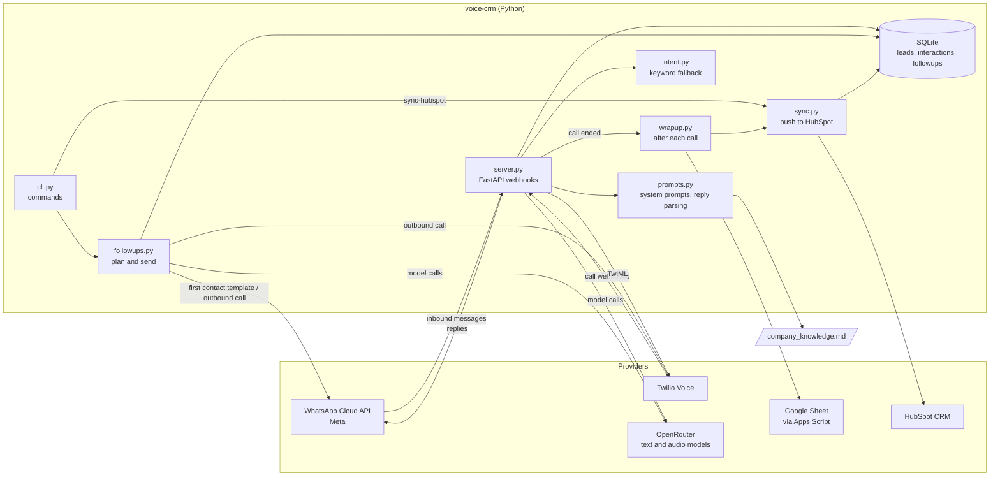
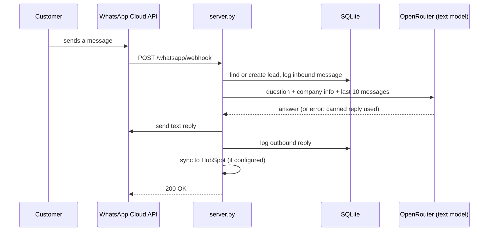
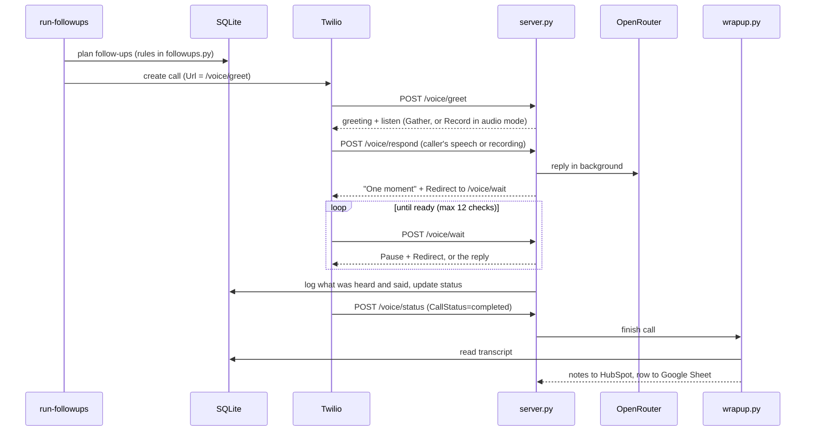

# Architecture

voice-crm is one Python service with three entry points: the webhook server (`voice-crm serve`), the follow-up job (`voice-crm run-followups`), and the CRM sync (`voice-crm sync-hubspot`). SQLite is the working store. HubSpot and a Google Sheet receive copies.

## Components

## Inbound WhatsApp message

## Outbound follow-up call

## Design decisions

- **SQLite is the source of truth.** HubSpot and the sheet are write-only mirrors. If either is down, the agent keeps working and the next sync catches up.
- **Dry run is the default.** `DRY_RUN=1` stops all outbound WhatsApp, Twilio, HubSpot, and sheet writes. Model calls return canned text.
- **Model replies never block Twilio.** Twilio gives a webhook only a few seconds. The reply is computed in a background thread, and Twilio polls `/voice/wait` until it's ready.
- **Two voice input modes.** `VOICE_INPUT=record` sends the caller's audio to an omni model. `VOICE_INPUT=speech` uses Twilio's speech recognition and a text model. Speech mode works on trial accounts.
- **Failures fall back, not fail.** A model error gives a safe spoken or written line. One bad WhatsApp message does not block the batch. A HubSpot outage does not stop the sheet row.
- **Functional style.** Logic is plain functions over values. Network calls and database writes sit at the edges: `whatsapp.py`, `voice.py`, `openrouter.py`, `hubspot.py`, `sheets.py`, `crm.py`, and `server.py`.

## Configuration

Every setting comes from environment variables (`.env`). See `.env.example`. The app loads `.env` on startup, and variables already set in the shell take precedence.
